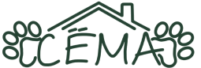

# 🐾 Зоогостиница и кинологический центр «Сёма» (Syoma Pet Hotel)

> **Премиальный веб-сервис для загородного отеля передержки кошек и собак без клеток в Подмосковье.**  
> Полный цикл разработки: от UX-исследований страхов владельцев и бренд-айдентики до адаптивной вёрстки, SEO-оптимизации и Telegram-автоматизации.

[](https://semahotel.ru)
[](https://semahotel.ru)
[](LICENSE)
[](https://www.python.org/)
[](https://github.com/astral-sh/ruff)

<p align="center">
  
</p>

---

## 🏷️ Теги проекта (Keywords & Topics)

`web-design` · `ui-ux` · `landing-page` · `responsive-design` · `pet-hotel` · `zoohotel` · `frontend` · `vanilla-js` · `telegram-bot` · `cynology` · `photography` · `seo-friendly` · `hatchling` · `ruff` · `figma`

---

## 📖 О проекте и концепция

**Зоогостиница «Сёма»** — проект комфортной загородной передержки собак и кошек без стресса и решеток (с. Заворово для собак и с. Макаровка для кошек, Раменский район / Бронницы). 

Сайт спроектирован так, чтобы с первой секунды снимать базовый страх разлуки у хозяина и доказывать безопасность проживания любимца через прозрачность, открытые фотографии номеров и регулярные видеоотчеты.

### 🌟 Ключевые фишки и разделы

- **Мгновенная Hero-сегментация**: разделение сценариев для владельцев собак и кошек прямо в первом экране.
- **Интерактивный каталог условий без клеток**:
  - Табы переключения «Собаки» / «Кошки» с фиксированными честными ценами без скрытых звездочек.
  - Кастомные фотогалереи с эффектом матового стекла (*Frosted Glass*).
- **Кинологический центр и дрессировка**:
  - Программы: щенячий курс, бытовое послушание (УГС), курс ОКД, коррекция поведения и онлайн-консультации.
- **Персональные фотосессии животных**:
  - Анималистическая съемка: индивидуальные кадры в лесу, совместные фото «Хозяин + Хвостик».
- **Социальная ответственность**:
  - Льготные условия передержки и бесплатные фотосессии для кураторов и приютов спасенных животных.
- **Бронирование и отзывы**:
  - Быстрая отправка заявок с моментальной доставкой в Telegram.
  - Интерактивный рейтинг с фильтрацией и защитой персональных данных по 152-ФЗ.

---

## 🎨 Дизайн-система и палитра

- **Гарнитура**: [Manrope](https://fonts.google.com/specimen/Manrope) — геометрический современный гротеск с превосходной читаемостью на экранах смартфонов.
- **Природная биофильная палитра**:
  - **Deep Forest Pine** (`#1C3D2D` / `#2D4436`) — символ природы, стабильности и лесного выгула.
  - **Warm Terracotta** (`#CE5E37`) — акцентный теплый оттенок для кнопок целевого действия (CTA).
  - **Cozy Cream** (`#FAF8F5`) — мягкий домашний фон без агрессивного белого блеска.
  - **Sage Whisper** (`#E4ECE7`) — деликатные бейджи преимуществ и статусов безопасности.

---

## 🛠 Технологический стек и архитектура

| Направление | Стек технологий |
|---|---|
| **Frontend** | HTML5, CSS3 (Modern Flexbox, CSS Grid, Custom Properties), Vanilla JavaScript (ES6+) |
| **Backend & Bot** | Python 3.11+, pyTelegramBotAPI, Pydantic v2 (настройки и валидация), python-dotenv |
| **Инструменты и сборка** | Hatchling (`pyproject.toml`), UV, Ruff Linter |
| **SEO & Соответствие РФ** | Микроразметка Schema.org (`LocalBusiness`, `FAQPage`), Open Graph, 152-ФЗ Политика конфиденциальности, Cookie Consent Banner |
| **Инфраструктура** | Хостинг Рег.ру (Боевой продакшн `semahotel.ru`) + GitHub Actions CI/CD |

---

## 📁 Структура репозитория

```text
├── src/
│   └── bot/                  # Модульный пакет Telegram-бота и диспетчера заявок
│       ├── __init__.py
│       └── config.py         # Pydantic-модель конфигурации и настроек
├── images/                   # Графические ассеты, оптимизированные фото номеров и питомцев
├── index.html                # Главная страница лендинга с микроразметкой и формами
├── privacy.html              # Официальная Политика конфиденциальности (152-ФЗ)
├── styles.css                # Фирменная дизайн-система и адаптивная верстка
├── script.js                 # Интерактивная логика, слайдеры, табы, модалки
├── pyproject.toml            # Hatchling конфигурация и настройки линтера Ruff
├── .env.example              # Шаблон переменных окружения для запуска бота
├── LICENSE                   # All Rights Reserved (Защита авторских прав)
└── README.md                 # Документация проекта
```

---

## 👩‍💻 Автор проекта

- **Автор, UI/UX дизайнер и разработчик**: **Виктория Большакова** ([@Divavi95](https://github.com/Divavi95))
- **Официальный сайт**: [semahotel.ru](https://semahotel.ru)
- **Telegram для связи**: [@d1vavi](https://t.me/d1vavi)

---

## 🔒 Лицензия и авторские права

**Copyright © 2026 Виктория Большакова (Viktoria Bolshakova). All Rights Reserved.**  
Все права защищены. Дизайн, графические материалы, текст и программный код являются интеллектуальной собственностью автора. Копирование, распространение или коммерческое использование без письменного разрешения автора запрещено. Проект опубликован исключительно в целях демонстрации портфолио.
